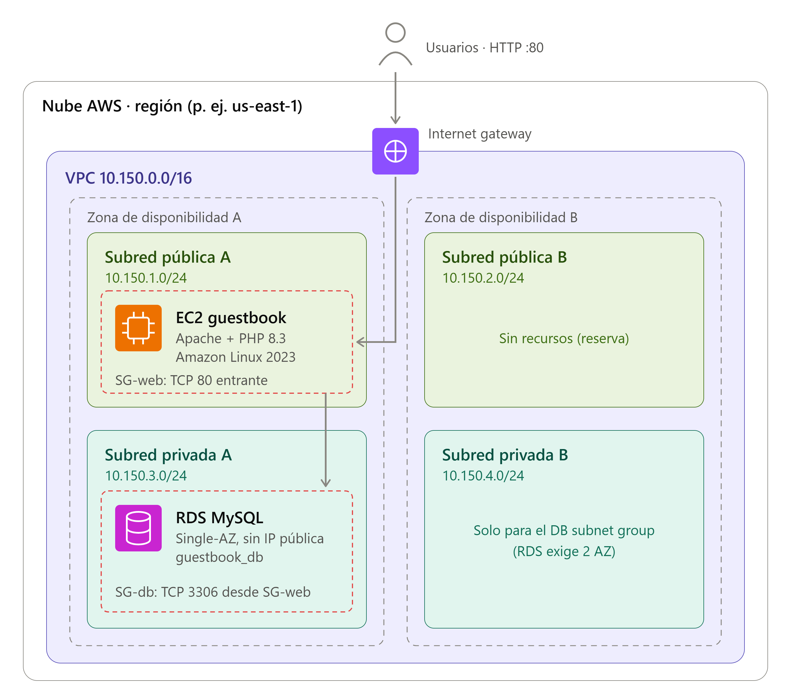

# Simple Guestbook Application
A guestbook application where visitors can leave messages

**Topics**: PHP, MySQL, AJAX, CSS, Guestbook, Web Development

## Arquitectura en AWS



| Componente | Detalle |
|---|---|
| VPC | `10.150.0.0/16` en 2 zonas de disponibilidad |
| Subred pública A | `10.150.1.0/24`: EC2 (Amazon Linux 2023, Apache + PHP 8.3) |
| Subred pública B | `10.150.2.0/24`: reserva para escalar |
| Subred privada A | `10.150.3.0/24`: RDS MySQL Single-AZ |
| Subred privada B | `10.150.4.0/24`: necesaria para el DB subnet group |
| SG-web | TCP 80 entrante |
| SG-db | TCP 3306 solo desde SG-web |

## Installation Process

### AMI LINUX 2023 - Requirements
```
sudo dnf upgrade -y
sudo dnf install -y httpd git php8.3 php8.3-fpm php8.3-pdo php8.3-mysqlnd mariadb105
sudo systemctl enable --now php-fpm httpd
```
```
cd ~
git clone https://github.com/mah-shamim/simple-guestbook-application.git
cd simple-guestbook-application
sudo mkdir -p /var/www/html/guestbook
sudo cp -r index.html *.php css js /var/www/html/guestbook/
```


### Database Setup
    Create a new AWS MySQL in RDS.
    Import the provided `guestbook.sql` file to set up the necessary table.
  
```
     mysql -h TU_ENDPOINT_RDS -P 3306 -u TU_USUARIO_RDS -p < guestbook.sql
```

     Alternativa, instalar mariadb en local para crear un monolito
```
     sudo dnf install -y mariadb105-server
     sudo systemctl enable --now mariadb
     sudo systemctl status mariadb --no-pager
     sudo mariadb
```
     
```
     CREATE DATABASE guestbook CHARACTER SET utf8mb4;

     CREATE USER 'guestbook'@'localhost' IDENTIFIED BY 'UnaClaveSegura_2026!';
     GRANT ALL PRIVILEGES ON guestbook.* TO 'guestbook'@'localhost';
     FLUSH PRIVILEGES;
``` 

### **Configure the Database Connection:**
   - Open the `config.php` file and update the database credentials.
   - sudo nano /var/www/html/guestbook/config.php
     ```php
     <?php
     // config.php
     $servername = "localhost";
     $username = "yourusername";
     $password = "yourpassword";
     $dbname = "guestbook_db";
     ```
     ```sh
     sudo systemctl restart php-fpm
     sudo systemctl restart httpd
      ```

### **Access the Application:r**
     ```sh
     http://EC2_PUBLIC_IP/guestbook/
     ```

**Test App**
```sh
curl -i --max-time 15 \
  --data-urlencode "name=Prueba" \
  --data-urlencode "message=Prueba desde EC2" \
  http://127.0.0.1/guestbook/submit.php
```

### File Structure

Here’s a basic file structure for your to-do list application:

```
simple-guestbook-application/
├── config.php
├── db.php
├── index.php
├── submit.php
├── fetch.php
├── css/
│   └── style.css
├── guestbook.sql
└── js/
    └── main.js
```
